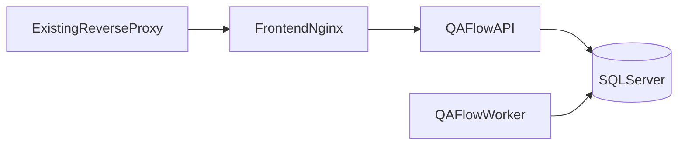
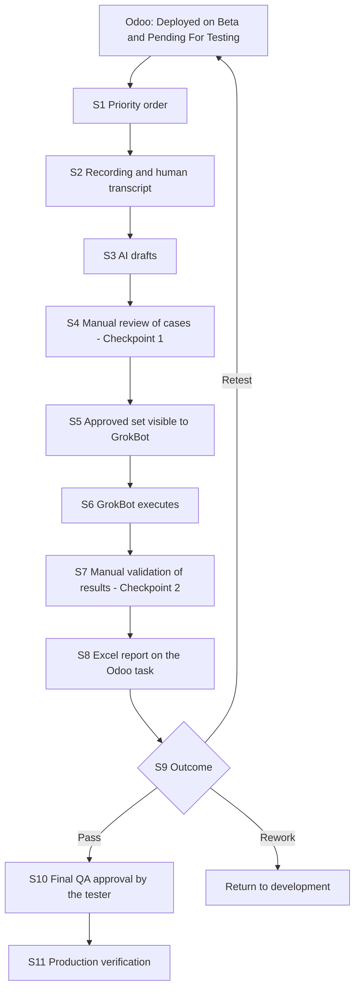
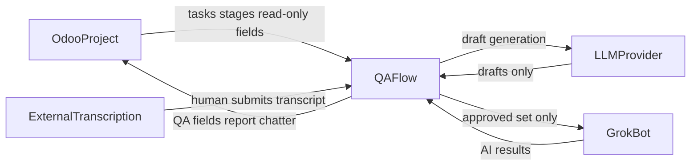

# QAFlow architecture

QAFlow is the internal QA management system for Main Fast Trade Technologies. It orchestrates the SOP workflow, stores QA data, and syncs with Odoo. It does not replace the tester.

This document describes the intended shape of the system. The bootstrap contains the process layout and integration seams only. Domain tables and QA-cycle behaviour are not built yet.

`docs/SOP.md` wins if this document and the SOP ever disagree.

## Runtime

One deployable system, not a set of microservices. No Redis and no Celery.

| Process | Role |
|---|---|
| `api` | FastAPI. HTTP for the UI, for GrokBot, and later for an MCP server. Owns schema migrations. |
| `worker` | Same image as the API. Idle until jobs exist. Future work is the retrying Odoo write-back. |
| `frontend` | React app served by nginx. The existing VPS reverse proxy has this container as its upstream. |
| `db` | Local SQL Server for development only. Production uses an external SQL Server via `DATABASE_URL`. |

The frontend nginx proxies `/health`, `/ready`, and `/api/` to the API so the browser talks to one origin. `VITE_API_BASE_URL` can point at a separate API host if the reverse proxy is split. That choice is still open (`docs/OPEN_QUESTIONS.md`).



## Modules

These are logical modules. None of them have tables or endpoints yet, apart from health checks.

| Module | SOP | Responsibility |
|---|---|---|
| Odoo sync | 8 | Read tasks, stages, and read-only fields. Write only the configured QA fields, the report, and chatter. |
| Prioritisation | S1 | Order in-scope tasks by Odoo priority, deadline, and urgency. Lead override requires a reason. |
| Requirement capture | S2 | Store the human transcript. QAFlow does not transcribe audio. |
| AI draft generation | S3 | Ask the LLM provider for user stories, requirements, expected behaviour, and test cases. Save drafts. |
| Review checkpoint | S4 | Per-case Approve, Modify, or Remove. No set proceeds without a decision on every case. |
| GrokBot handoff | S5 | Expose only an approved set. Removed cases are excluded. |
| Result validation | S6, S7 | Store AI results, then tester Confirm or Override. |
| Reporting | S8 | Task-wise Excel report, versioned, attached to the Odoo task. |
| Outcome and approval | S9, S10 | Pass, Rework, or Retest. Final approval is tester-only. |
| Production verification | S11 | Opt-in smoke checks. Not auto-queued from the production backlog. |
| Master repository | 6 | Module-wise cases. Version or retire. Never replace or hard-delete. |
| Audit | R13 | Who changed what, and when. Every state change enters through `services/workflow.py`. |
| Review flags | 9 | Signals for QA Lead and Admin. The system does not apply consequences. |
| Admin settings | 3, 8 | Users, templates, Odoo mapping. Field names and stage ids come from settings. |

## QA-cycle workflow

A cycle starts only when an Odoo task is in *Deployed on Beta and Pending For Testing*. Other stages do not create cycles. *Deployed on Production and Pending for Testing* is opt-in.



Gates already fixed by the SOP:

- No AI generation without a transcript.
- No execution until every case has an explicit human decision and the set is approved.
- No cycle outcome while any result is unvalidated.
- No move toward live without tester final approval.
- AI output stays a draft until a human acts.
- GrokBot results stay labelled "AI result" until the tester confirms or overrides them.

## Data flow



What QAFlow reads from Odoo and does not write: priority, deadline, stage (except the transitions the SOP names), assignee, estimated hours, actual hours, description, checkbox action points, and Task Sub Status.

What QAFlow may write, and only through the retrying job once write-back is enabled: QA Started, QA Passed, QA Cycles, the Excel report, and a chatter note. A failed Odoo write must not drop local state. Real write-back stays off until `ODOO_WRITEBACK_ENABLED` is set.

Temporary AI execution files are not permanent history. The Odoo task keeps the versioned Excel report.

## External systems

| System | Inside QAFlow? | Contract |
|---|---|---|
| Odoo 19 Enterprise, Project app | No | Source of tasks. QAFlow uses stages and the configured custom fields. There is no Quality, Helpdesk, or QA-tag module. |
| GrokBot | No | External executor. Uses the REST API and, later, the MCP server. Sees approved cases only. Cannot approve, edit cases, see drafts, or change the master repository. |
| LLM provider | No | Draft generation only. Provider, model, and credentials are settings. Output is never auto-approved. |
| Transcription tool | No | A person transcribes the recording elsewhere and submits the text. QAFlow does not call a speech-to-text API. |

Code seams, currently stubs that do not call the network:

- `backend/app/integrations/odoo.py`
- `backend/app/integrations/grokbot.py`
- `backend/app/integrations/llm.py`

## Code layout

```
backend/app/api/            thin routers, one Pydantic schema per endpoint
backend/app/services/       business logic; workflow.py is the state-change seam
backend/app/models/         SQLAlchemy models (base only until domain work starts)
backend/app/schemas/        request and response models
backend/app/integrations/   Odoo, GrokBot, LLM
backend/app/jobs/           worker process
backend/app/core/           settings, database, logging, process entry
```

State changes go through `services/workflow.py`. `record_state_change` writes a structured log line and, when a session is passed, an `audit_log` row. People sign in with email and password; the session is a JWT in an httpOnly cookie. `executor_bot` authenticates with a bearer API key.

## Persistence

SQL Server via SQLAlchemy 2, Alembic, and pyodbc (ODBC Driver 18). The first revision is an empty baseline, so a new database contains `alembic_version` and nothing else.
