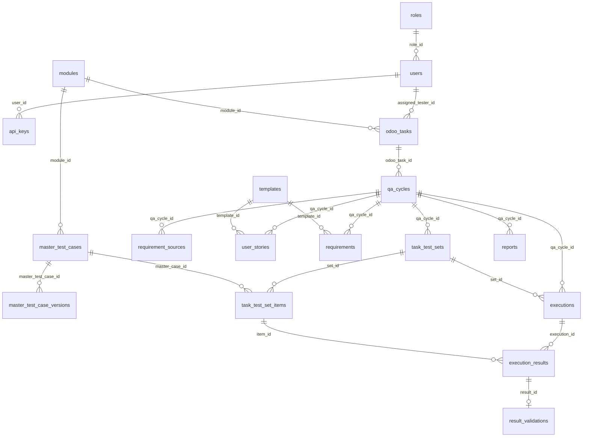

# Data model

SQL Server tables for QAFlow. `docs/SOP.md` is the source of truth. This schema stores the workflow. Odoo write-back is still off.

Odoo-owned columns on `odoo_tasks` (priority, deadline, stage, assignee, hours, sub-status, QA checkboxes, QA cycle count, description, checklist) are a mirror. They are ordinary columns so a sync can save them. Write-back is a later job, and it stays off until that job is enabled.

## Columns on every table

| Column | Meaning |
|---|---|
| `id` | `BIGINT` identity primary key |
| `created_at`, `updated_at` | `DATETIMEOFFSET`, default `SYSDATETIMEOFFSET()`. The ORM also sets `updated_at` on update |
| `created_by` | Nullable foreign key to `users.id`. No cascade |
| `row_version` | SQL Server `ROWVERSION`, used as the optimistic-concurrency token |

`created_by` is null on the seeded roles and on the first user.

## Identity credentials

- `users.password_hash` is nullable. A human password is stored as a bcrypt hash. `executor_bot` has no password.
- `api_keys.key_hash` is the SHA-256 hex digest of the full key. The plaintext key is shown once at creation and is not stored.
- `api_keys.last_used_at` is set when that key authenticates. `revoked_at` disables it.

## Entities

`review_flags`, `audit_log`, `jobs`, and `settings` stand alone. A flag or audit row points at a record with `entity_type` and `entity_id` (audit uses `entity` and `entity_id`) rather than a foreign key, because the target table varies.

## Values stored with a check constraint

| Column | Values |
|---|---|
| `roles.code` | `admin`, `qa_lead`, `tester`, `requirement_provider`, `viewer`, `executor_bot` |
| `templates.type` | `user_story`, `requirement`, `test_case`, `execution_result`, `report` |
| `requirement_sources.kind` | `recording`, `transcript` |
| `user_stories.status`, `requirements.status` | `draft`, `approved` |
| `master_test_cases.status` | `active`, `retired` |
| `master_test_cases.source` | `ai`, `human` |
| `task_test_sets.status` | `draft`, `in_review`, `approved`, `sent` |
| `task_test_set_items.origin` | `master_regression`, `ai_new`, `manual_new` |
| `task_test_set_items.review_decision` | `pending`, `approved`, `modified`, `removed` |
| `qa_cycles.outcome` | `PASS`, `REWORK`, `RETEST` (null until S9) |
| `execution_results.ai_result` | `PASSED`, `FAILED`, `BLOCKED`, `ERROR` |
| `result_validations.decision` | `confirmed`, `overridden` |
| `reports.type` | `task`, `master` |
| `jobs.status` | `pending`, `running`, `succeeded`, `failed` |

`requirement` is a template type because SOP R11 requires a requirements template. `qa_cycles.status`, `executions.status`, `master_test_cases.type`, and `master_test_cases.priority` are plain strings. The SOP does not list allowed values. See `docs/OPEN_QUESTIONS.md`.

## Uniqueness

| Constraint | Why |
|---|---|
| `roles.code` | One row per role code. The migration seeds the six codes |
| `users.email` | One account per email |
| `api_keys.key_hash` | A key hash is stored once. The hash is SHA-256 of the full key. The plaintext is not stored |
| `modules.name` | One master repository per module name |
| `odoo_tasks.odoo_id` | One mirror row per Odoo task |
| `templates (type, version)` | A template version is not inserted twice |
| `templates.type` where `is_active = 1` | One active template per type |
| `qa_cycles (odoo_task_id, cycle_no)` | A task cannot have two cycles with the same number |
| `master_test_cases (module_id, case_no)` | Case numbers are unique inside a module |
| `master_test_case_versions (master_test_case_id, version_no)` | A version number is not repeated |
| `execution_results (execution_id, item_id)` | A GrokBot resubmit cannot duplicate a case result |
| `result_validations.result_id` | One tester decision per AI result |
| `reports (qa_cycle_id, type, version)` | Regenerating a report versions it instead of posting a duplicate |
| `settings.key` | One value per setting key |

Foreign keys do not cascade. Master cases and cycle history are not removed by deleting a parent. Every foreign-key column has an index. `odoo_tasks (odoo_stage, deadline)` supports later priority ordering. `jobs (status, run_at)` supports the worker poll.
